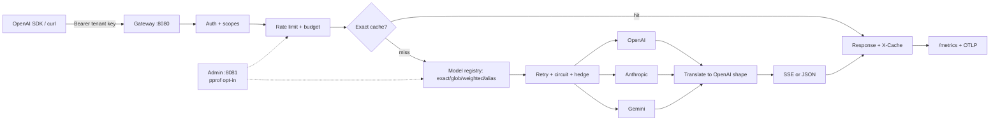

# LLM API Gateway

[](https://github.com/Francisco-cor/LLM-API-Gateway/actions/workflows/ci.yaml)
[](go.mod)
[](LICENSE)

**One OpenAI-compatible endpoint in front of OpenAI, Anthropic and Gemini.** Point an OpenAI SDK at the gateway, keep your client code, and get fallback, streaming, rate limits, budgets, caching and observability without adopting a Python proxy stack.

> **Status: `v1.1.0` — production-oriented beta, not a finished product.**
> The data plane is solid and tested. The control plane is still a YAML file plus a process-local admin API; there is no Postgres, no tenant/key CRUD, no usage ledger and no Helm chart. The honest gap list and the plan are in **[`docs/ROADMAP.md`](docs/ROADMAP.md)**. If you need multi-tenant billing or a control plane today, read [“When this is not for you”](#when-this-is-not-for-you) first.

---

## Why it exists

You have one app and three model vendors. You do not want three SDKs, three retry policies and three dashboards. The gateway gives you:

- **A stable contract** — `POST /v1/chat/completions`, `POST /v1/embeddings`, `GET /v1/models`; OpenAI-shaped requests, responses, errors and SSE.
- **Provider choice without client changes** — route `gpt-*`, `claude-*` and `gemini-*` to their APIs, with alias remapping on fallback.
- **Resilience as code** — retry with jitter, circuit breaker, hedge for non-streaming calls, fallback before the first SSE chunk.
- **Cost and traffic control** — per-client request/token buckets (local or Redis), monthly token/USD budgets, pricing catalog, exact and opt-in semantic cache.
- **Operability** — health/readiness, Prometheus, OTLP traces, redacted logs, validated hot reload and an admin API that fails closed.

It is a single Go binary with a small dependency set (see `go.mod`; 8 direct modules) and no framework.

---

## Quick start (under 2 minutes)

### Docker Compose

```bash
git clone https://github.com/Francisco-cor/LLM-API-Gateway.git
cd LLM-API-Gateway

cp .env.example .env
# Edit .env: set at least one of OPENAI_API_KEY / ANTHROPIC_API_KEY / GEMINI_API_KEY.
# Optional: GATEWAY_API_KEY, ADMIN_API_KEY, REDIS_URL.

docker compose up --build -d
docker compose ps
curl -s http://localhost:8080/health | jq
# { "status": "ok", "uptime_seconds": 1.2, "start_time": "...", "ready": true }
```

The default `config.yaml` has `auth.enabled: false`, so the demo below needs no `Authorization` header. The production profile (`config.prod.yaml`) requires `GATEWAY_API_KEY` and `ADMIN_API_KEY` and enables budgets.

> The process exits with `no providers configured` if no provider key is set. That is intentional: the gateway does not ship a mock mode.

### Docker

```bash
docker build -t llm-api-gateway .
docker run --rm -p 8080:8080 \
  -e OPENAI_API_KEY="$OPENAI_API_KEY" \
  -e ADMIN_API_KEY="$ADMIN_API_KEY" \
  llm-api-gateway
```

### Local Go

```bash
export OPENAI_API_KEY="sk-..."                # or ANTHROPIC_API_KEY / GEMINI_API_KEY
go run ./cmd/gateway -config config.dev.yaml   # auth disabled, admin loopback, text logs
# or: make dev                                   # air live-reload if installed, else go run
```

---

## Demo

Use a model that belongs to the provider key you configured. The examples below assume `OPENAI_API_KEY` and the shipped `config.yaml`.

```bash
# Chat
curl -s http://localhost:8080/v1/chat/completions \
  -H 'Content-Type: application/json' \
  -d '{
    "model": "gpt-4o",
    "messages": [{"role":"user","content":"Explain a token bucket in one sentence."}],
    "max_tokens": 64
  }' | jq '{id, object, model, choices: [.choices[] | {finish_reason, content: .message.content}], usage}'

# Streaming SSE
curl -N http://localhost:8080/v1/chat/completions \
  -H 'Content-Type: application/json' \
  -d '{"model":"gpt-4o","messages":[{"role":"user","content":"Count to 3"}],"stream":true}'
# data: {"id":"...","object":"chat.completion.chunk",...}
# data: [DONE]

# Embeddings
curl -s http://localhost:8080/v1/embeddings \
  -H 'Content-Type: application/json' \
  -d '{"model":"text-embedding-3-small","input":["hello","world"]}' | jq '{object, model, usage, dimensions: (.data[0].embedding | length)}'

# Models and provider health
curl -s http://localhost:8080/v1/models | jq '.data[].id'
curl -s http://localhost:8080/health/providers | jq

# Which provider served the request?
curl -sS -D - -o /dev/null http://localhost:8080/v1/chat/completions \
  -H 'Content-Type: application/json' \
  -d '{"model":"gpt-4o","messages":[{"role":"user","content":"hi"}],"max_tokens":8}' \
  | grep -i x-gateway-provider
```

With `auth.enabled: true`, add `-H "Authorization: Bearer $GATEWAY_API_KEY"`.

Metrics and admin:

```bash
curl -s http://localhost:8080/metrics | grep -E '^gateway_(requests_total|provider_errors_total|circuit_state)'

# Admin requires ADMIN_API_KEY when admin.allow_insecure is false.
# GET /admin/config serializes Go field names, and durations as integer nanoseconds.
curl -s http://127.0.0.1:8081/admin/config \
  -H "Authorization: Bearer $ADMIN_API_KEY" | jq '.Admin.APIKey'
# "***"
```

The admin listener binds to `127.0.0.1` by default. In Docker Compose, `config.yaml` therefore keeps the admin API **inside the container** even though the port is published; expose it deliberately with a config that sets `admin.bind_address` and a network/ACL. pprof is not on `:6060`: it is opt-in inside the admin mux (`admin.pprof_enabled: true`).

More runnable clients: [`examples/curl`](examples/curl), [`examples/openai-python`](examples/openai-python), [`examples/openai-node`](examples/openai-node), [`examples/langchain`](examples/langchain), [`examples/postman`](examples/postman).

---

## What is implemented (verified)

| Capability | Status | Notes |
|---|---|---|
| OpenAI chat completions | Yes | Text, multimodal content parts (OpenAI passthrough), tools, tool results, `response_format.type`, audio fields, logprobs, `seed`, `n`, `stop`, `max_completion_tokens` |
| Tools, streaming, usage | Yes | Anthropic/Gemini native tool contracts; SSE `data: [DONE]`; `stream_options.include_usage` when the provider returns usage |
| Embeddings | Yes (OpenAI, Gemini) | Anthropic has no embeddings API |
| Models endpoint | Yes | Configured registry, wildcard/regex matching, optional auto-discovery via upstream `/models` |
| Providers | 3 | `openai`, `anthropic`, `gemini`; adapters implement `Provider` (+ `Embedder`) |
| Routing | Yes | Exact, glob, regex, weighted canary, `model_aliases` on fallback |
| Resilience | Yes | Retry 3× with jitter, circuit breaker 5 failures → 30 s open → 1 half-open probe, hedge 300 ms for **non-streaming**, fallback before first SSE chunk |
| Rate limiting | Yes | 16-shard token bucket, TTL cleanup, token-aware `AllowWithLimits`, per-tenant/model overrides, Redis Lua, local fallback on Redis failure |
| Budget | Yes | Atomic monthly token/USD reservation and commit, versioned pricing catalog, `insufficient_quota` / `budget_unavailable` |
| Cache | Yes | Exact LRU or Redis, identity- and shape-scoped keys, `X-Cache-Skip` / `X-Cache-TTL`; opt-in semantic cache via embeddings. **No runtime memory fallback if Redis dies**; streams are never cached |
| Admin | Yes | Redacted config, validated reload, provider list, hot knobs, `SIGHUP`, 1 s file watcher |
| Health | Yes | `/health`, `/health/providers`, `/livez`, `/readyz` with drain semantics and cached provider checks |
| Observability | Yes | Prometheus metrics, OTLP/gRPC traces, `slog` with `request_id`/tenant/provider/latency; **`/metrics` is unauthenticated** |
| Auth | Yes | Static tenant keys, scopes, expiry; admin fail-closed and constant-time compare |
| HTTP hardening | Yes | 1 MiB request cap, unknown-field rejection, 8 MiB upstream cap, CORS allowlist, `nosniff`/`DENY`/`no-referrer` |
| Deployment | Manifests | Dockerfile (non-root, read-only root FS in K8s), Deployment/HPA/PDB/ServiceMonitor. **No Helm/Terraform** |
| Persistence / tenancy / billing | **No** | Static YAML, no CRUD, no usage ledger, no reconciliation. See roadmap |

Not implemented: `/v1/responses`, audio transcription, files/batches, Realtime, fine-tuning, prompt guardrails, PII redaction, SSRF allowlisting, idempotency keys, capability-aware routing, generic OpenAI-compatible provider, Azure/Bedrock/Vertex, UI.

---

## Architecture



- Canonical format is OpenAI (`internal/types`); Anthropic/Gemini translation lives in `internal/translate`.
- The registry resolves exact → weighted exact → weighted pattern → pattern; wildcard patterns are glob-to-regex.
- The data plane holds state in memory plus Redis; there is no database.
- Full C4, component map, sequence diagram and corrected operational caveats: [`docs/ARCHITECTURE.md`](docs/ARCHITECTURE.md). Decisions: [`docs/adr`](docs/adr).

---

## Configuration

Config is YAML with `${ENV}` expansion and strict unknown-field rejection. Provider keys may be empty (provider disabled); the process requires at least one enabled provider.

| Key | Meaning |
|---|---|
| `server.port`, `server.read_timeout`, `server.write_timeout` | Listen port and HTTP timeouts (`8080`, `30s`, `60s`). `ReadHeaderTimeout` is 5 s, `IdleTimeout` 120 s. |
| `providers.<name>.api_key` | Expanded from `${ENV}` at load. Empty/unexpanded disables the provider. |
| `providers.<name>.base_url` | Upstream base URL. **No SSRF allowlist today.** |
| `providers.<name>.timeout` | Per-provider HTTP client timeout. |
| `providers.<name>.models` | Exact names, globs (`gpt-4*`), regex, or `[]` for auto-discovery. |
| `fallback_chain` | Ordered providers to try on retryable 429/5xx. |
| `model_aliases` | Model remap when falling back, e.g. `gpt-4o: [claude-sonnet-4-6]`. |
| `routing.weighted` | Canary/blue-green weights per model. |
| `resilience.retry/circuit/hedge` | `max_attempts`, `base_delay`, `max_delay`; `failure_threshold`, `open_timeout`; `hedge.enabled/delay`. |
| `rate_limit.*` | `enabled`, `requests_per_minute`, `burst`, `redis_url`, `token_aware`, `tokens_per_minute`, `token_burst`, `overrides`. |
| `rate_limit.budget.*` | `enabled`, `monthly_tokens`, `monthly_usd`, `cost_per_token_usd`, `pricing.catalog`. |
| `cache.*` | `enabled`, `ttl`, `max_size`, `semantic_enabled`, `semantic_threshold`, `semantic_embedding_model`, `semantic_top_k`, `semantic_max_entries`. |
| `health.*` | `readiness_cache_ttl`, `check_timeout`, `provider_timeout`, `skip_expensive_checks`. |
| `auth.enabled/keys` | Static keys with `tenant`, `scopes`, `expires_at`. |
| `admin.port`, `admin.bind_address`, `admin.api_key`, `admin.allow_insecure`, `admin.pprof_enabled` | Admin listener. Defaults: `8081`, `127.0.0.1`, fail closed, pprof off. |
| `cors.allowed_origins` | CORS allowlist; empty disables CORS. |
| `logging.level`, `logging.format` | `debug/info/warn/error`, `json/text`. |

Environment variables:

| Variable | Required | Purpose |
|---|---|---|
| `OPENAI_API_KEY` | one provider | OpenAI key |
| `ANTHROPIC_API_KEY` | one provider | Anthropic key |
| `GEMINI_API_KEY` | one provider | Gemini key |
| `GATEWAY_API_KEY` | if `auth.enabled` | Tenant key in the production profile |
| `ADMIN_API_KEY` | production | Admin auth; empty + `allow_insecure: false` refuses to start |
| `REDIS_URL` | optional | Distributed rate limit, budget, cache |
| `OTEL_EXPORTER_OTLP_ENDPOINT` | optional | OTLP/gRPC collector (`host:port`, `http://`, `https://`) |
| `OTEL_TRACES_EXPORTER` | optional | `none` disables export but keeps local trace IDs |

Two profiles ship in the repo: `config.dev.yaml` (no auth, debug logs, loopback admin) and `config.prod.yaml` (auth, budget, `0.0.0.0` admin bind, pprof off). Kubernetes uses `deploy/k8s/configmap.yaml`.

---

## Operations

| Endpoint | Behavior |
|---|---|
| `GET /health`, `/livez` | 200 while the process is alive; `ready` flips false during drain |
| `GET /readyz` | 503 when draining or zero healthy providers; provider result cached |
| `GET /health/providers` | 200 + per-provider map; `overall: degraded` when any status is not `healthy` (including `skipped`) |
| `GET /metrics` | Prometheus exposition; **not authenticated** |
| `POST /admin/reload` | Re-read the config file; validation failure → 400 with old config active |
| `PATCH /admin/config` | Hot knobs: rate limit, cache, health, resilience, routing, logging |
| `GET /admin/config`, `/admin/providers` | Redacted config (Go field names) and provider list |
| `GET /debug/pprof/*` | Only when `admin.pprof_enabled: true`, under the admin mux and admin auth |

Hot reload covers providers, fallback, aliases, weights, limits, budget, pricing, cache, auth keys, health options and resilience. It does **not** cover `admin.port`, `admin.bind_address`, `admin.api_key`, `admin.pprof_enabled` or `server.*`; those need a restart.

Runbooks for Redis outage, provider 429/5xx, open circuits, exhausted budget, cut streams, key rotation and profiling: [`docs/RUNBOOK.md`](docs/RUNBOOK.md). Proposed SLOs and alert thresholds are there too; they are not measured yet.

---

## Benchmarks

There are Go microbenchmarks for the limiter, cache and key builder. There are **no reproducible end-to-end throughput numbers committed** in this repo state, and there is no mock provider mode: the `k6` script in `tests/load` points at a real upstream, so its p95 target is not comparable to gateway overhead.

```bash
go test ./tests -run '^$' -bench=. -benchmem -count=1
go test ./tests -run '^$' -bench='Benchmark(Limiter|Cache|BuildKey)' -benchmem -count=3
```

Last recorded local reference (Windows AMD64, Go 1.24, 2026-09-01, not re-measured for this release) is kept in [`BENCH.md`](BENCH.md) with its command and caveats. Treat those figures as **local reference, not a guarantee**; hardware and load shape change the result. See the roadmap for the missing load harness (R-28/R-29).

---

## Tests

```bash
go test ./... -race -cover
go test ./tests/contract -run TestContract -v
go vet ./...
make bench
make vulncheck
```

The contract suite runs against `httptest`-backed providers with no external network: response shape, SSE `[DONE]`, unknown model 404, unknown-field 400, validation, `Retry-After`. CI runs tests with `-race`, golangci-lint and govulncheck; coverage is uploaded as an artifact. **No coverage badge or coverage gate is claimed here.** A prior measurement with `-coverpkg` was around 53%, and it has not been re-run for this release.

---

## Comparison (honest)

| | This gateway `v1.1.0` | LiteLLM Proxy | Portkey / hosted gateways |
|---|---|---|---|
| Language / deploy | Go single binary + Redis | Python; Postgres/Redis; container | Hosted/self-hosted hybrid |
| OpenAI compatibility | Chat, embeddings, models, SSE, tools | Broad, many endpoints | Broad |
| Providers | 3 (OpenAI, Anthropic, Gemini) | Many | Many |
| Control plane | YAML + process-local admin; **no DB** | DB-backed virtual keys, budgets, UI | Managed control plane, guardrails, analytics |
| Multi-tenant billing | Monthly counters only; **no ledger** | Yes | Yes |
| Cache | Exact + opt-in semantic | Exact + semantic + Redis | Yes |
| Resilience | Retry, circuit, hedge (non-stream), fallback | Retry/fallback/routing | Retry/fallback/routing |
| Observability | Prometheus + OTLP + structured logs | Prometheus/OTEL + integrations | Hosted analytics |
| Ops packaging | Docker + raw K8s manifests | Helm/compose | SaaS or Helm |
| Best fit | Go teams that want a small, inspectable data plane and are willing to build the control plane | Teams that want batteries-included tenancy today | Teams that want a vendor-managed platform |

Choose this if you value a small Go codebase you can read end to end, want to own the routing/resilience logic, and are prepared to invest in persistence (roadmap phases 2–3). Do not choose it if you need tenant CRUD, invoicing, SSO, 20+ providers or compliance features this week.

### When this is not for you

- You need **self-service API keys, usage dashboards or invoices** — no control plane/ledger yet.
- You handle **regulated PII** — no classification/redaction, cache stores response bodies unencrypted.
- You need **20+ providers** or Azure/Bedrock/Vertex — only 3 adapters today.
- You need **active-active multi-region** — state is local + optional Redis; no global control plane.
- You cannot run Redis but need **global** rate limits across replicas — the local fallback multiplies limits.

The plan to close these gaps, with acceptance criteria and effort, is in **[`docs/ROADMAP.md`](docs/ROADMAP.md)**.

---

## Contributing, security, license

- Setup, make targets, PR criteria and how to add a provider: [`CONTRIBUTING.md`](CONTRIBUTING.md).
- Report vulnerabilities via **GitHub private security advisory**; details and threat model: [`SECURITY.md`](SECURITY.md).
- Changelog: [`CHANGELOG.md`](CHANGELOG.md). Version: `VERSION`.
- MIT — see [`LICENSE`](LICENSE).
