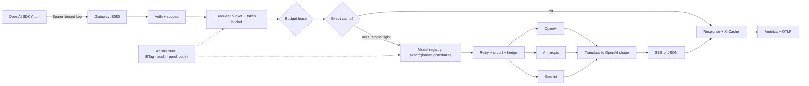

# LLM API Gateway

[](https://github.com/Francisco-cor/LLM-API-Gateway/actions/workflows/ci.yaml)
[](go.mod)
[](LICENSE)

**One OpenAI-compatible endpoint in front of OpenAI, Anthropic and Gemini.** Point an OpenAI SDK at the gateway, keep your client code, and get fallback, streaming, rate limits, budgets, caching and observability without adopting a Python proxy stack.

> **Status: `v1.1.1` — production-oriented beta, not a finished product.**
> The data plane is solid and tested. The control plane is still a YAML file plus a process-local admin API; there is no Postgres, no tenant/key CRUD, no usage ledger and no Helm chart. The honest gap list and the plan are in **[`docs/ROADMAP.md`](docs/ROADMAP.md)**. If you need multi-tenant billing or a control plane today, read [“When this is not for you”](#when-this-is-not-for-you) first.

---

## Why it exists

You have one app and three model vendors. You do not want three SDKs, three retry policies and three dashboards. The gateway gives you:

- **A stable contract** — `POST /v1/chat/completions`, `POST /v1/embeddings`, `GET /v1/models`; OpenAI-shaped requests, responses, errors and SSE.
- **Provider choice without client changes** — route `gpt-*`, `claude-*` and `gemini-*` to their APIs, with alias remapping on fallback.
- **Resilience as code** — retry with jitter, circuit breaker, hedge for non-streaming calls, fallback before the first SSE chunk.
- **Cost and traffic control** — per-client request/token buckets (local or Redis), monthly token/USD budgets, pricing catalog, exact and opt-in semantic cache.
- **Operability** — health/readiness, Prometheus, OTLP traces, redacted logs, validated hot reload and an admin API that fails closed and rotates its key live.

It is a single Go binary with a small dependency set (see `go.mod`; 8 direct modules) and no framework.

---

## Quick start (under 2 minutes)

### Docker Compose

```bash
git clone https://github.com/Francisco-cor/LLM-API-Gateway.git
cd LLM-API-Gateway

cp .env.example .env
# Edit .env: set at least one of OPENAI_API_KEY / ANTHROPIC_API_KEY / GEMINI_API_KEY.
# Optional: GATEWAY_API_KEY, ADMIN_API_KEY, AUTH_KEY_PEPPER, REDIS_URL.

docker compose up --build -d
docker compose ps
curl -s http://localhost:8080/health | jq
# { "status": "ok", "uptime_seconds": 1.2, "start_time": "...", "ready": true }
```

The default `config.yaml` has `auth.enabled: false`, so the demo below needs no `Authorization` header. The production profile (`config.prod.yaml`, `docker compose --profile prod`) requires `GATEWAY_API_KEY` and `ADMIN_API_KEY`, enables budgets with `require_shared_store: true`, and is meant to run with `GATEWAY_ENV=prod` (strict validation). The K8s manifests already set `GATEWAY_ENV=prod`.

> The process exits with `no providers configured` if no provider key is set. That is intentional: the gateway does not ship a mock mode.

### Docker

```bash
docker build -t llm-api-gateway .
docker run --rm -p 8080:8080 \
  -e OPENAI_API_KEY="$OPENAI_API_KEY" \
  -e ADMIN_API_KEY="$ADMIN_API_KEY" \
  llm-api-gateway
```

### Local Go

```bash
export OPENAI_API_KEY="sk-..."                # or ANTHROPIC_API_KEY / GEMINI_API_KEY
go run ./cmd/gateway -config config.dev.yaml   # auth disabled, admin loopback, text logs
# or: make dev                                   # air live-reload if installed, else go run
```

Production-like startup with strict validation (also enforced on every reload):

```bash
GATEWAY_ENV=prod ./gateway -config config.prod.yaml
# equivalent: ./gateway -strict -config config.prod.yaml
```

`--strict` / `GATEWAY_ENV=prod` additionally require `auth.enabled: true`, an admin key, `admin.allow_insecure: false`, pprof off, no wildcard CORS, `https` provider URLs (unless `allow_private: true`) and a Redis URL for shared limits. Validation errors are printed one per line and the process does not start.

---

## Demo

Use a model that belongs to the provider key you configured. The examples below assume `OPENAI_API_KEY` and the shipped `config.yaml`.

```bash
# Chat
curl -s http://localhost:8080/v1/chat/completions \
  -H 'Content-Type: application/json' \
  -d '{
    "model": "gpt-4o",
    "messages": [{"role":"user","content":"Explain a token bucket in one sentence."}],
    "max_tokens": 64
  }' | jq '{id, object, model, choices: [.choices[] | {finish_reason, content: .message.content}], usage}'

# Streaming SSE
curl -N http://localhost:8080/v1/chat/completions \
  -H 'Content-Type: application/json' \
  -d '{"model":"gpt-4o","messages":[{"role":"user","content":"Count to 3"}],"stream":true}'
# data: {"id":"...","object":"chat.completion.chunk",...}
# data: [DONE]          <- only on a complete stream
#
# If the provider dies mid-stream:
# event: error
# data: {"error":{"message":"...","type":"provider_error","code":"stream_truncated"}}
# (and NO [DONE]: [DONE] means success)

# Embeddings
curl -s http://localhost:8080/v1/embeddings \
  -H 'Content-Type: application/json' \
  -d '{"model":"text-embedding-3-small","input":["hello","world"]}' | jq '{object, model, usage, dimensions: (.data[0].embedding | length)}'

# Models and provider health
curl -s http://localhost:8080/v1/models | jq '.data[].id'
curl -s http://localhost:8080/health/providers | jq

# Which provider served the request?
curl -sS -D - -o /dev/null http://localhost:8080/v1/chat/completions \
  -H 'Content-Type: application/json' \
  -d '{"model":"gpt-4o","messages":[{"role":"user","content":"hi"}],"max_tokens":8}' \
  | grep -i x-gateway-provider
```

With `auth.enabled: true`, add `-H "Authorization: Bearer $GATEWAY_API_KEY"`. A key must declare at least one allowed scope (`chat:write`, `embeddings:write`, `models:read`, `admin:write`, `resource:<name>`, `*`); the server refuses to start otherwise unless `auth.require_scopes: false` is set explicitly.

Metrics and admin:

```bash
curl -s http://localhost:8080/metrics | grep -E '^gateway_(requests_total|provider_errors_total|circuit_state|stream_ttft_seconds)'

# Admin requires ADMIN_API_KEY when admin.allow_insecure is false.
# GET /admin/config serializes Go field names, and durations as integer nanoseconds.
curl -sS -D - http://127.0.0.1:8081/admin/config \
  -H "Authorization: Bearer $ADMIN_API_KEY" | jq '.Admin.APIKey'
# "***"
# The response carries an ETag; send If-Match on PATCH to avoid lost updates (409 on mismatch).
```

The admin listener binds to `127.0.0.1` by default. In Docker Compose, `config.yaml` therefore keeps the admin API **inside the container** even though the port is published; expose it deliberately with a config that sets `admin.bind_address` and a network/ACL. pprof is not on `:6060`: it is opt-in inside the admin mux (`admin.pprof_enabled: true`) and still requires the admin key.

More runnable clients: [`examples/curl`](examples/curl), [`examples/openai-python`](examples/openai-python), [`examples/openai-node`](examples/openai-node), [`examples/langchain`](examples/langchain), [`examples/postman`](examples/postman).

---

## What is implemented (verified)

| Capability | Status | Notes |
|---|---|---|
| OpenAI chat completions | Yes | Text, multimodal content parts (OpenAI passthrough), tools, tool results, `response_format` incl. `json_schema`, audio fields, logprobs, `seed`, `n`, `stop`, `max_completion_tokens`. Unknown request fields are tolerated and ignored; only the model/messages shape is validated. |
| Tools, streaming, usage | Yes | Provider-native tool contracts; `index` on choices and tool-call deltas; real provider usage in the final SSE chunk when `stream_options.include_usage` is set; rolling 60 s write deadline; **truncated streams emit `event: error` and no `[DONE]`** |
| Embeddings | Yes (OpenAI, Gemini) | Anthropic has no embeddings API; embeddings have their own budget/retry/cache path |
| Models endpoint | Yes | Configured registry, wildcard/regex matching, optional auto-discovery via upstream `/models` |
| Providers | 3 | `openai`, `anthropic`, `gemini`; adapters implement `Provider` (+ `Embedder`) |
| Routing | Yes | Exact, glob, regex, weighted canary, `model_aliases` on fallback |
| Resilience | Yes | Retry 3× with jitter, circuit breaker 5 failures → 30 s open → 1 half-open probe, hedge 300 ms for **non-streaming**, fallback before first SSE chunk |
| Rate limiting | Yes | 16-shard token bucket, TTL cleanup; **separate token bucket measured in tokens** (`tokens_per_minute`/`token_burst`), per-tenant/model overrides with isolated buckets, Redis Lua, local fallback on Redis failure |
| Budget | Yes | Atomic monthly token/USD reservation with **leases** (TTL + reconciliation), UTC months, versioned per-million pricing catalog, cached-token rates, `require_shared_store` fail-closed mode, `insufficient_quota` / `budget_unavailable` |
| Cache | Yes | Exact LRU or Redis, byte budget (`max_bytes`), TTL cap (`max_ttl`), `X-Cache-Skip` / `X-Cache-TTL`, **single-flight** for concurrent chat misses, semantic cache with one embedding per request, real Redis stats. Streams are never cached and there is no runtime memory fallback if Redis dies |
| Admin | Yes | Redacted config, validated reload, provider list, hot knobs, live key rotation, `ETag`/`If-Match`, audit records, `SIGHUP`, 1 s file watcher with retry/backoff |
| Health | Yes | `/health`, `/health/providers`, `/livez`, `/readyz` with drain semantics and cached provider checks; readiness survives client disconnects |
| Observability | Yes | Prometheus metrics (incl. stream TTFT/duration), OTLP/gRPC traces, `slog` with `request_id`/tenant/provider/latency; **`/metrics` is unauthenticated** |
| Auth | Yes | Static tenant keys, mandatory scopes (fail-closed), expiry, HMAC-SHA256 pepper (`auth.key_pepper` / `AUTH_KEY_PEPPER`), 32-char minimum in production, per-IP 401 throttle |
| HTTP hardening | Yes | **8 MiB** request cap (vision/audio), 8 MiB upstream cap, trailing-JSON rejection, CORS allowlist, `nosniff`/`DENY`/`no-referrer`; config and admin stay strict on unknown fields |
| Deployment | Manifests | Dockerfile (non-root, read-only root FS in K8s), Deployment/HPA/PDB/ServiceMonitor/NetworkPolicy/ServiceAccount/topology spread; multi-arch image, SBOM and cosign signing on tag. **No Helm/Terraform** |
| Persistence / tenancy / billing | **No** | Static YAML, no CRUD, no usage ledger, no reconciliation. See roadmap |

Not implemented: `/v1/responses`, audio transcription, files/batches, Realtime, fine-tuning, prompt guardrails, PII redaction, idempotency keys, capability-aware routing, generic OpenAI-compatible provider, Azure/Bedrock/Vertex, UI, usage ledger, Postgres control plane.

---

## Architecture



- Canonical format is OpenAI (`internal/types`); Anthropic/Gemini translation lives in `internal/translate`.
- The registry resolves exact → weighted exact → weighted pattern → pattern; wildcard patterns are glob-to-regex.
- The data plane holds state in memory plus Redis; there is no database.
- Full C4, component map, sequence diagram and corrected operational caveats: [`docs/ARCHITECTURE.md`](docs/ARCHITECTURE.md). Decisions: [`docs/adr`](docs/adr).

---

## Configuration

Config is YAML with `${ENV}` expansion and strict unknown-field rejection at the control plane. Provider keys may be empty (provider disabled); the process requires at least one enabled provider. A `${VAR}` left unresolved is treated as missing rather than as a literal secret.

| Key | Meaning |
|---|---|
| `server.port`, `server.read_timeout`, `server.write_timeout` | Listen port and HTTP timeouts (`8080`, `30s`, `60s`). `ReadHeaderTimeout` is 5 s, `IdleTimeout` 120 s. Bind/port require a restart to change. |
| `providers.<name>.api_key` | Expanded from `${ENV}` at load. Empty/unexpanded disables the provider. |
| `providers.<name>.base_url` | Upstream base URL. Strict mode requires `https` and rejects metadata/private/loopback hosts unless `allow_private: true` (for a trusted local Ollama/vLLM). |
| `providers.<name>.allow_private` | Opt-in for `http` and private addresses in strict mode. Metadata endpoints remain blocked. |
| `providers.<name>.timeout` | Per-provider HTTP client timeout. |
| `providers.<name>.models` | Exact names, globs (`gpt-4*`), regex, or `[]` for auto-discovery. |
| `fallback_chain` | Ordered providers to try on retryable 429/5xx. |
| `model_aliases` | Model remap when falling back, e.g. `gpt-4o: [claude-sonnet-4-6]`. |
| `routing.weighted` | Canary/blue-green weights per model. |
| `resilience.retry/circuit/hedge` | `max_attempts`, `base_delay`, `max_delay`; `failure_threshold`, `open_timeout`; `hedge.enabled/delay`. |
| `rate_limit.*` | `enabled`, `requests_per_minute`, `burst`, `redis_url`, `token_aware`, `tokens_per_minute`, `token_burst`, `overrides`. Token limits are in **tokens**, not requests. |
| `rate_limit.overrides[]` | `tenant`, `model_pattern`, `rpm`, `burst`; most specific rule wins and each matched override gets an isolated bucket. |
| `rate_limit.budget.*` | `enabled`, `monthly_tokens`, `monthly_usd`, `cost_per_token_usd`, `require_shared_store`, `reservation_ttl`, `pricing.catalog`. |
| `rate_limit.budget.pricing.catalog[]` | Rates **per 1M tokens**: input, output, embedding, optional `cache_read_*`/`cache_write_*`. Wildcards allowed. |
| `cache.*` | `enabled`, `ttl`, `max_size`, `max_bytes`, `max_ttl`, `semantic_enabled`, `semantic_threshold`, `semantic_embedding_model`, `semantic_top_k`, `semantic_max_entries`. |
| `health.*` | `readiness_cache_ttl`, `check_timeout`, `provider_timeout`, `skip_expensive_checks`. |
| `auth.enabled/keys` | Static keys with `tenant`, mandatory `scopes`, `expires_at`. |
| `auth.require_scopes` | Defaults to `true`. Set `false` only for a deliberate deny-all key. |
| `auth.key_pepper` | HMAC-SHA256 pepper for stored key hashes. Prefer `AUTH_KEY_PEPPER`. Changing it invalidates old hashes (keys are re-hashed on reload). |
| `admin.port`, `admin.bind_address`, `admin.api_key`, `admin.allow_insecure`, `admin.pprof_enabled` | Admin listener. Defaults: `8081`, `127.0.0.1`, fail closed, pprof off. The key rotates on reload; bind/port/pprof need a restart. |
| `cors.allowed_origins` | CORS allowlist; empty disables CORS. Reloadable. |
| `logging.level`, `logging.format` | `debug/info/warn/error`, `json/text`. Level is reloadable; format requires a restart. |

Environment variables:

| Variable | Required | Purpose |
|---|---|---|
| `OPENAI_API_KEY` | one provider | OpenAI key |
| `ANTHROPIC_API_KEY` | one provider | Anthropic key |
| `GEMINI_API_KEY` | one provider | Gemini key |
| `GATEWAY_API_KEY` | if `auth.enabled` | Tenant key in the production profile |
| `ADMIN_API_KEY` | production | Admin auth; empty + `allow_insecure: false` refuses to start |
| `AUTH_KEY_PEPPER` | recommended | HMAC pepper for tenant-key hashes (equivalent to `auth.key_pepper`) |
| `REDIS_URL` | optional / strict with limits | Distributed rate limit, budget, cache |
| `GATEWAY_ENV` | optional | `prod` enables the same strict validation as `--strict` |
| `GATEWAY_REPLICAS` | optional | Replica count used only to warn when a budget runs without a shared store |
| `OTEL_EXPORTER_OTLP_ENDPOINT` | optional | OTLP/gRPC collector (`host:port`, `http://`, `https://`) |
| `OTEL_TRACES_EXPORTER` | optional | `none` disables export but keeps local trace IDs |

Two profiles ship in the repo: `config.dev.yaml` (no auth, debug logs, loopback admin) and `config.prod.yaml` (auth, budget, `0.0.0.0` admin bind, pprof off). Kubernetes uses `deploy/k8s/configmap.yaml`.

### Strict mode

`--strict` or `GATEWAY_ENV=prod` adds a second validation pass at startup **and on every hot reload**:

- `auth.enabled` must be true and every key must be ≥ 32 characters with at least one scope.
- `admin.api_key` must be set, `admin.allow_insecure` must be false and `admin.pprof_enabled` must be false.
- CORS must not contain `*`.
- Placeholder provider keys are not allowed for providers in `fallback_chain`.
- Provider `base_url` must be `https`, must not point at `/localhost`, private, loopback, link-local or cloud metadata addresses; `allow_private: true` relaxes the scheme/private-address rule for a trusted local backend.
- Rate limiting and budgets require `REDIS_URL`; a budget also requires `rate_limit.budget.require_shared_store: true`.

---

## Operations

| Endpoint | Behavior |
|---|---|
| `GET /health`, `/livez` | 200 while the process is alive; `ready` flips false during drain |
| `GET /readyz` | 503 when draining or zero healthy providers; provider result cached |
| `GET /health/providers` | 200 + per-provider map; `overall: degraded` when any status is not `healthy` (including `skipped`) |
| `GET /metrics` | Prometheus exposition; **not authenticated** |
| `GET /admin/config` | Redacted config + `ETag` |
| `POST /admin/reload` | Re-read the config file; validation failure → 400 with old config active |
| `PATCH /admin/config` | Hot knobs (rate limit, cache, health, resilience, routing, logging, auth, CORS); send `If-Match` to get 409 instead of overwriting a concurrent change |
| `GET /admin/providers` | Provider list |
| `GET /debug/pprof/*` | Only when `admin.pprof_enabled: true`, under the admin mux and admin auth |

Hot reload covers providers, fallback, aliases, weights, limits, token limits, overrides, budget, pricing, cache, auth (including `auth.enabled` and the pepper), CORS, `logging.level`, the admin API key, health options and resilience. It does **not** cover `server.*`, `admin.port`, `admin.bind_address`, `admin.pprof_enabled` or `logging.format`; those require a restart and a reload that tries to change them is rejected (format only logs a warning and keeps the current handler). The file watcher retries a failed apply with backoff; a Redis outage does not block the rest of the reload.

Runbooks for Redis outage, provider 429/5xx, open circuits, exhausted budget, truncated streams, strict mode, admin key rotation, ETag conflicts, scopes and profiling: [`docs/RUNBOOK.md`](docs/RUNBOOK.md). Proposed SLOs and alert thresholds are there too; they are not measured yet.

---

## Benchmarks

Microbenchmarks exist for the limiter, the in-memory cache and the cache-key builder. They measure those components, **not gateway throughput**, and the repository still has no committed end-to-end load test.

Last measured locally on **2026-11-13**, commit `f8663d0`, inside `golang:1.24-alpine` on an **AMD Ryzen 5 3600X (12 threads)**, `go test ./tests -run '^$' -bench=. -benchmem -count=3`:

| Benchmark | Range over 3 runs | Allocations |
|---|---|---|
| `BenchmarkLimiter_Allow` | 254–424 ns/op | 3 allocs/op |
| `BenchmarkLimiter_Allow_Sharded` | 334–353 ns/op | 3 allocs/op |
| `BenchmarkLimiter_AllowN_Token` | 232–306 ns/op | 3 allocs/op |
| `BenchmarkBuildKey` | 2.15–2.61 µs/op | 7 allocs/op |
| `BenchmarkCache_Get_Hit` | 98–113 ns/op | 1 alloc/op |
| `BenchmarkCache_Get_Miss` | 16.4–17.1 ns/op | 0 allocs/op |

Treat these as a local reference, not a capacity claim. The exact command, hardware fields and caveats are in [`BENCH.md`](BENCH.md).

```bash
go test ./tests -run '^$' -bench=. -benchmem -count=3
go test ./tests -run '^$' -bench='Benchmark(Limiter|Cache|BuildKey)' -benchmem -count=5 -benchtime=2s
```

---

## Tests

```bash
go test ./... -race -cover
go test ./tests/contract -run TestContract -v
REDIS_URL=redis://127.0.0.1:6379/0 go test -tags=integration ./... -count=1
go vet ./...
make bench
make vulncheck
```

The contract suite runs against `httptest`-backed providers with no external network: response shape, SSE `[DONE]` and truncated-stream errors, the 400/404/413/429/502/503 mapping, unknown-model 404, tolerant unknown fields, validation and `Retry-After`. The Redis integration suite is opt-in with `-tags=integration` and requires `REDIS_URL`; if no integration-tagged files are present, the command still succeeds and runs the normal suite.

CI runs tests with `-race`, measures coverage with `-coverpkg=./...`, enforces a **55 % floor**, runs golangci-lint v2 and govulncheck, and builds the image. This session measured **66.0 %** (`go test ./... -coverpkg=./...`, 2026-11-13, commit `f8663d0`, Go 1.24 in Docker). Coverage is a floor, not a quality claim.

---

## Comparison (honest)

| | This gateway `v1.1.1` | LiteLLM Proxy | Portkey / hosted gateways |
|---|---|---|---|
| Language / deploy | Go single binary + Redis | Python; Postgres/Redis; container | Hosted/self-hosted hybrid |
| OpenAI compatibility | Chat, embeddings, models, SSE, tools, `json_schema` passthrough | Broad, many endpoints | Broad |
| Providers | 3 (OpenAI, Anthropic, Gemini) | Many | Many |
| Control plane | YAML + process-local admin; **no DB** | DB-backed virtual keys, budgets, UI | Managed control plane, guardrails, analytics |
| Multi-tenant billing | Monthly counters only; **no ledger** | Yes | Yes |
| Cache | Exact + opt-in semantic, single-flight | Exact + semantic + Redis | Yes |
| Resilience | Retry, circuit, hedge (non-stream), fallback | Retry/fallback/routing | Retry/fallback/routing |
| Observability | Prometheus + OTLP + structured logs | Prometheus/OTEL + integrations | Hosted analytics |
| Ops packaging | Docker + raw K8s manifests (NetworkPolicy included) | Helm/compose | SaaS or Helm |
| Best fit | Go teams that want a small, inspectable data plane and are willing to build the control plane | Teams that want batteries-included tenancy today | Teams that want a vendor-managed platform |

Choose this if you value a small Go codebase you can read end to end, want to own the routing/resilience logic, and are prepared to invest in persistence (roadmap phases 2–3). Do not choose it if you need tenant CRUD, invoicing, SSO, 20+ providers or compliance features this week.

### When this is not for you

- You need **self-service API keys, usage dashboards or invoices** — no control plane/ledger yet.
- You handle **regulated PII** — no classification/redaction, cache stores response bodies unencrypted.
- You need **20+ providers** or Azure/Bedrock/Vertex — only 3 adapters today.
- You need **active-active multi-region** — state is local + optional Redis; no global control plane.
- You cannot run Redis but need **global** rate limits across replicas — the local fallback multiplies limits. Strict mode refuses this configuration.
- You need **DNS-rebinding-safe SSRF protection** — strict mode validates scheme, host and literal private/metadata IPs, but there is no resolver-level pinning or redirect allowlist.

The plan to close these gaps, with acceptance criteria and effort, is in **[`docs/ROADMAP.md`](docs/ROADMAP.md)**.

---

## Contributing, security, license

- Setup, make targets, PR criteria and how to add a provider: [`CONTRIBUTING.md`](CONTRIBUTING.md).
- Report vulnerabilities via **GitHub private security advisory**; details and threat model: [`SECURITY.md`](SECURITY.md).
- Changelog: [`CHANGELOG.md`](CHANGELOG.md). Version: `VERSION`.
- MIT — see [`LICENSE`](LICENSE).
