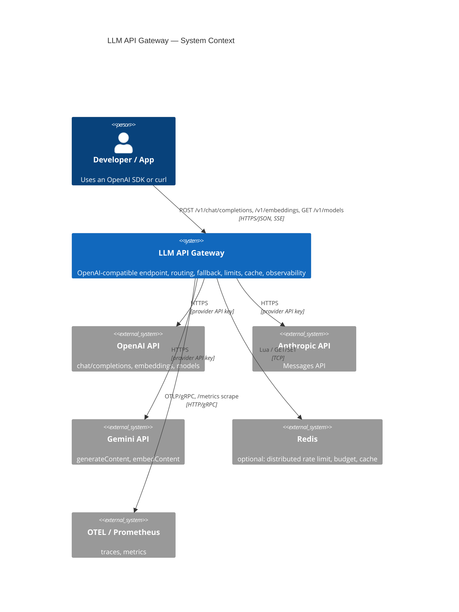
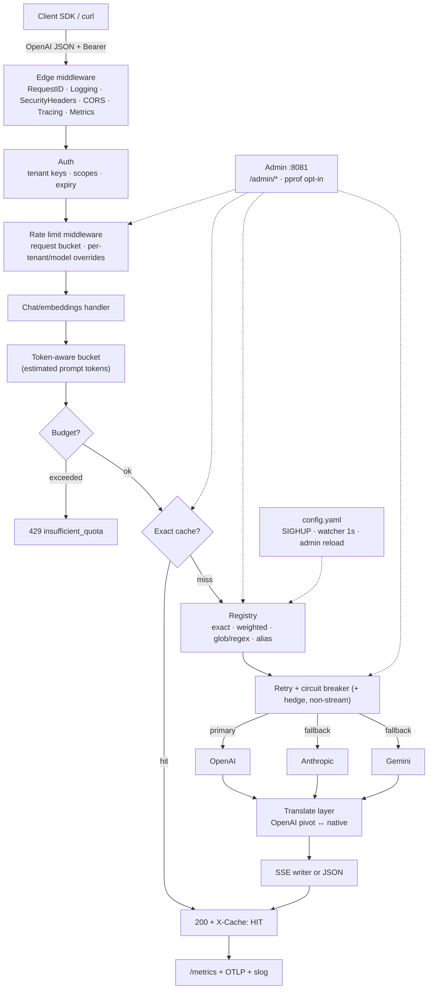
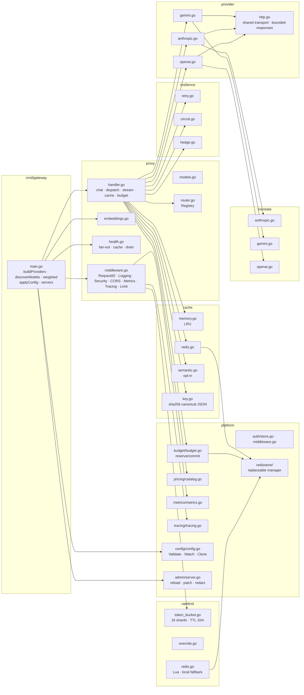
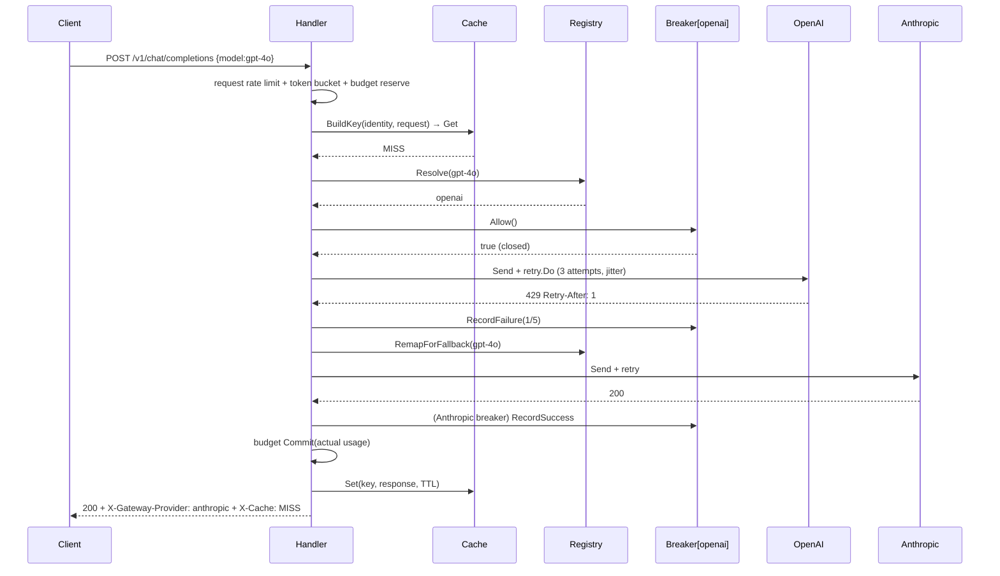

# Architecture — LLM API Gateway

> **Version:** 1.1 · **Date:** 2026-11-13 · **Stack:** Go 1.24, `net/http`, `prometheus/client_golang`, `go-redis/v9`, OpenTelemetry, `yaml.v3`
> This doc follows C4: Context → Container → Component. It describes what the code does today, including its limits.

---

## 1. C4 Context



**External actors**

- **Clients** speak the OpenAI schema; the gateway is a drop-in `base_url` replacement.
- **Upstreams** are isolated behind `Provider`; a new provider is an adapter, not a change to the HTTP contract (today the adapter list is still hardcoded in `buildProviders`).
- **Operators** use the admin API (separate listener, separate key) and the config file/watcher.

**There is no database.** The control plane is the YAML file plus process memory. This is the main architectural gap for multi-tenant product use; see `ADR-004`.

---

## 2. C4 Container



**Processes / listeners**

| Listener | Port | Handler | Notes |
|---|---|---|---|
| Gateway | `8080` | `cmd/gateway/main.go`; `http.Server` with `ReadHeaderTimeout 5s`, `IdleTimeout 120s` | `/v1/*`, `/health*`, `/livez`, `/readyz`, `/metrics` |
| Admin | `8081`, bind `127.0.0.1` by default | `internal/admin/server.go` | `/admin/*`; pprof routes only when `admin.pprof_enabled: true` |
| pprof | **same admin listener** | `net/http/pprof` handlers mounted in the admin mux | No separate `:6060`; off by default; admin auth applies |
| Redis | `6379` | `go-redis/v9` behind `internal/redisstore` | Optional; rate limit falls back local, budget fails closed, cache misses |
| Postgres | — | **not implemented** | Roadmap phase 2 |

The Dockerfile still `EXPOSE`s `6060` for historical reasons; nothing listens there in this version.

---

## 3. C4 Component — `internal/`



### Key contracts

**`Provider`** (`internal/provider/provider.go`):

```go
type Provider interface {
    Name() string
    Send(ctx context.Context, req ChatRequest) (ChatResponse, error)
    SendStream(ctx context.Context, req ChatRequest) (<-chan StreamChunk, <-chan error)
    Models() []string
    HealthCheck(ctx context.Context) error
}
type Embedder interface {
    Embed(ctx context.Context, req EmbeddingRequest) (EmbeddingResponse, error)
}
```

- `Name()` is the registry key and the `fallback_chain` entry.
- `Send` is synchronous; `SendStream` returns channels. The handler waits for the first stream event before committing HTTP 200, so an early failure can still fall back.
- `Models()` may contain exact names, globs (`gpt-4*`), regex-like patterns, or be empty for auto-discovery.
- Errors are `*ProviderError{Retryable, RetryAfter, StatusCode}`; `provider.IsRetryable` decides fallback. `Retry-After` is propagated to the client.

**`Registry`** (`internal/proxy/router.go`) resolution order:

1. weighted exact model (`routing.weighted`);
2. exact model;
3. weighted pattern keys matching the model (longer patterns first, lexical tie-break);
4. provider pattern (`glob` → regex, `path.Match` fallback), random among multiple candidates;
5. `ErrNoProvider` → HTTP `404 model_not_found`.

`Reload(providers, aliases, weighted)` swaps state under an `RWMutex`; handlers keep their pointers. `RemapForFallback` uses `model_aliases`, then the fallback provider's first model.

**Translate** (`internal/translate/`):

- Canonical shape is OpenAI. `ToAnthropic` extracts `system`, maps `assistant → assistant` messages, maps tools to `tool_use`/`tool_result`, and defaults `max_tokens` to **4096** when absent. Anthropic version is `2023-06-01`.
- `ToGemini` maps messages to `contents` (`assistant → model`), tools to `functionDeclarations`, and tool results to `functionResponse`.
- Unsupported multimodal details use a safe text projection; the OpenAI adapter keeps the full content parts.
- Gemini authenticates with `x-goog-api-key`; the key is not placed in the URL.

---

## 4. Sequence — non-streaming fallback



Details that matter:

- **Retry** applies to non-streaming `Send` (default 3 attempts with jitter) and to embeddings. Streaming does **not** retry a provider; it tries the next provider only if the failure happens before the first chunk.
- **Hedge** is non-streaming only. It races the primary against up to two fallbacks after `resilience.hedge.delay` (300 ms default). It is off by default.
- **Circuit breaker** is per provider, in-process, 5 failures → open 30 s → half-open with 1 probe. There is no shared breaker state across replicas and no reset endpoint.
- **Budget** reserves an estimate before dispatch and commits actual usage after; a failed request cancels the reservation. When a Redis budget is configured and unavailable, the request fails with `503 budget_unavailable` (fail-closed). Without Redis, budget state is per process.
- **Cache** stores only 200 non-streaming responses. Streaming sets `Cache-Control: no-cache`; the gateway does **not** read or honor upstream `Cache-Control`.

**Streaming path**

1. Resolve model; check breaker; call `SendStream`.
2. Wait for the first chunk or error. On retryable error, try the next provider with a remapped model.
3. If a provider succeeds: set `Content-Type: text/event-stream`, `Cache-Control: no-cache`, `Connection: keep-alive`, `X-Gateway-Provider`; clear the server write deadline; write chunks as `data: {...}` with `Flush`.
4. On normal close: `data: [DONE]`.
5. On mid-stream provider error: `event: error` + OpenAI error JSON + `data: [DONE]`.
6. On client disconnect: stop via request context; no resume support.

Streams have no retry, no hedge, no cache and no usage reconciliation beyond the provider's final usage chunk. A mid-stream cut cannot be transparently moved to another provider.

---

## 5. Data flow — limits, budget, cache

- **Request rate limit** (`proxy/middleware.go`): applies only to `/v1/*`; health, readiness and metrics stay probeable. The key is a SHA-256 of the authenticated tenant, else the `Authorization` value, else the remote host. Per-tenant/model overrides use a model-scoped bucket suffix so a high-limit model cannot refill the shared bucket. On 429 it sets `Retry-After` and `X-RateLimit-Limit`/`Remaining`. Redis uses a Lua token bucket; on Redis error it logs/marks degraded and uses the local bucket.
- **Token limit** (`proxy/handler.go`, `internal/ratelimit`): independent bucket in tokens. The estimate is `chars/4` over message text plus the JSON of tools; it is **not** a tokenizer. A prompt can still exceed the real provider token count. The bucket size is `rate_limit.token_burst`, not the request burst.
- **Override store** (`ratelimit/override.go`): `tenant` + `model_pattern` → RPM/burst. `""`/`*` match as wildcards; the most specific match wins.
- **Budget** (`budget/budget.go`): monthly token/USD usage keyed by tenant and month. Redis: Lua `HINCRBY`/`HINCRBYFLOAT` with quota check in one script; local: mutex + map. Reservation, then commit actual or cancel. `pricing.Catalog` resolves provider/model (exact or wildcard) and can fall back or reject unknown prices. Limits and pricing swap atomically on reload; existing usage is preserved.
- **Cache** (`cache/`): exact key is `sha256(canonical JSON)` over response-shaping fields (model, messages, sampling, tools, tool choice, response format, stop, n, stream options, user), then salted with the client identity. Embedding keys include model/input/format/dimensions/user. Backend is **either** in-memory LRU **or** Redis, chosen when the cache is built; there is no layered fallback. Semantic mode embeds the query, searches a namespace-scoped in-process top-k index and retrieves the exact cached response; namespaces include identity and shape. It is opt-in and local to a process.

---

## 6. Operational concerns

- **Hot reload:** `config.Watch(ctx, path, 1s, onChange)` polls mtime with a 100 ms debounce; `SIGHUP` and `POST /admin/reload` share `applyConfig`. Order: `Validate` → build providers → auto-discover → build weighted → build pricing → `redisStore.ReplaceURL` (ping/swap/close, keep old on failure) → `registry.Reload` → limiter/overrides → budget → auth → health options → rebuild cache → resilience → fallback chains → admin config snapshot. A failed reload keeps the previous state.
- **Not hot-reloadable:** `server.*`, `admin.port`, `admin.bind_address`, `admin.api_key`, `admin.pprof_enabled`. The admin server and pprof routes are built once at startup; rotating the admin key requires a restart.
- **Admin config JSON:** config structs have YAML tags only, so `GET /admin/config` uses Go field names (`Admin.APIKey`) and `time.Duration` values as integer nanoseconds. `PATCH /admin/config` accepts duration strings. Secrets are redacted to `***`.
- **Graceful drain:** `SIGTERM`/`SIGINT` → `health.SetReady(false)` → `/readyz` 503 → 5 s wait for endpoint removal → admin shutdown (5 s) → gateway `Shutdown` (30 s). The K8s grace period is 35 s; long streams may be cut after 30 s.
- **Observability:** metrics are `gateway_requests_total`, `gateway_request_duration_seconds`, `gateway_tokens_total`, `gateway_cost_usd_total`, `gateway_provider_errors_total`, `gateway_circuit_state`, `gateway_cache_hits_total`, `gateway_cache_size`. Path labels are bounded to known routes. `/metrics` is not authenticated. There is no queue depth, Redis health, budget remaining or gateway-overhead metric yet.
- **Security:** tenant auth is a static key store with SHA-256 digests (constant-time compare), scopes and expiry. The admin uses a separate key with constant-time compare and is fail-closed unless `allow_insecure` is explicitly set. pprof is opt-in and contains secrets. `base_url` is operator-controlled but not SSRF-validated. See `SECURITY.md`.

---

## 7. Deployment

`deploy/k8s/` contains raw manifests, not a chart:

- `deployment.yaml`: 3 replicas, RollingUpdate, `terminationGracePeriodSeconds: 35`, probes `/livez` (10 s), `/readyz` (5 s), `/health` (startup), requests `500m/256Mi`, limits `1000m/512Mi`, `readOnlyRootFilesystem`, `runAsNonRoot: 65532`, dropped capabilities.
- `hpa.yaml`: 3 → 10 replicas, CPU 70 %, memory 80 %.
- `pdb.yaml`: `minAvailable: 2`.
- `service.yaml`: HTTP 80 → 8080; separate admin Service 8081.
- `servicemonitor.yaml`: scrapes `/metrics` on 8080 every 15 s.
- `configmap.yaml`: production profile with auth and budget; `admin.bind_address: 0.0.0.0`, pprof off.

No Helm, no Terraform, no migration job, no NetworkPolicy. The Dockerfile `EXPOSE 6060` is stale; pprof is on the admin listener.

---

## 8. Trade-offs and known gaps

- **Own limiter/circuit instead of libraries:** small surface, hot-reloadable config, but fewer edge cases covered than `golang.org/x/time/rate` or a mature breaker library. Benchmarks are microbenchmarks, not capacity evidence.
- **`ServeMux` instead of a framework:** Go 1.22 patterns are enough; no Gin/Echo dependency.
- **In-process state + Redis:** simple and fast, but per-replica semantics for local fallbacks, semantic cache and budget without Redis.
- **YAML control plane:** excellent for a demo and single-node ops; insufficient for tenant CRUD, audit, multi-replica consistency and billing.
- **Known gaps:** Postgres/migrations, tenant/key CRUD, usage ledger, quotas per tenant, capability registry, generic OpenAI-compatible provider, Azure/Bedrock/Vertex, idempotency, SSRF guard, secret manager, PII, SLOs/backpressure, Helm/Terraform, UI. Full plan and acceptance criteria: `docs/ROADMAP.md`.

Refs: `BENCH.md`, `config.yaml`, `config.dev.yaml`, `config.prod.yaml`, `deploy/`, `examples/`, `docs/adr/`.
