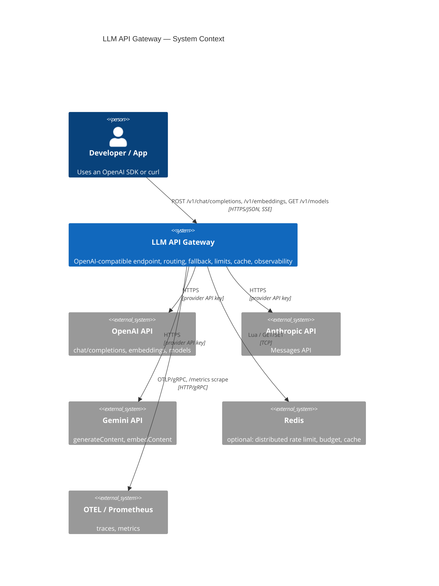
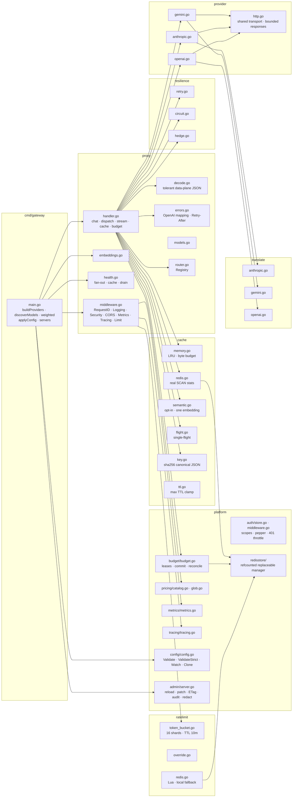
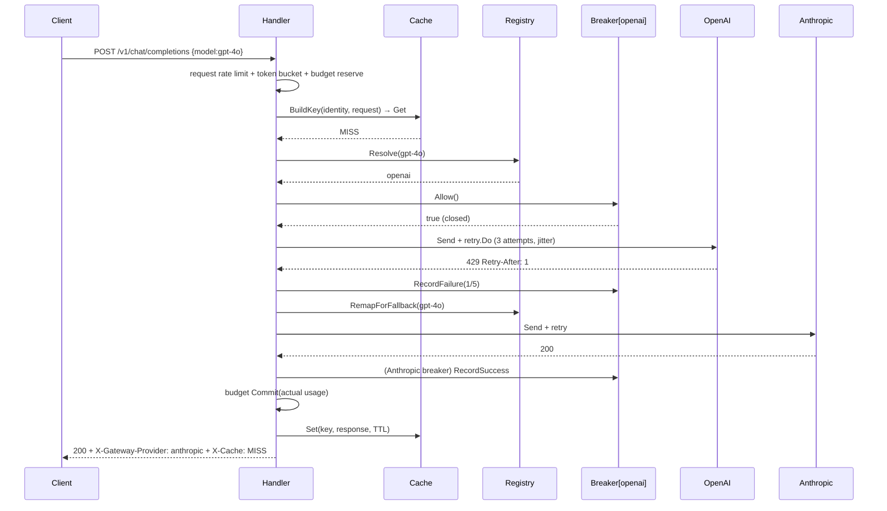

# Architecture — LLM API Gateway

> **Version:** 1.2 · **Date:** 2026-11-13 · **Stack:** Go 1.26, `net/http`, `prometheus/client_golang`, `go-redis/v9`, OpenTelemetry, `yaml.v3`
> This doc follows C4: Context → Container → Component. It describes what the code does today, including its limits.

---

## 1. C4 Context



**External actors**

- **Clients** speak the OpenAI schema; the gateway is a drop-in `base_url` replacement.
- **Upstreams** are isolated behind `Provider`; a new provider is an adapter, not a change to the HTTP contract (today the adapter list is still hardcoded in `buildProviders`).
- **Operators** use the admin API (separate listener, separate key) and the config file/watcher.

**There is no database.** The control plane is the YAML file plus process memory. This is the main architectural gap for multi-tenant product use; see `ADR-004`.

---

## 2. C4 Container


**Processes / listeners**

| Listener | Port | Handler | Notes |
|---|---|---|---|
| Gateway | `8080` | `cmd/gateway/main.go`; `http.Server` with `ReadHeaderTimeout 5s`, `IdleTimeout 120s` | `/v1/*`, `/health*`, `/livez`, `/readyz`, `/metrics` |
| Admin | `8081`, bind `127.0.0.1` by default | `internal/admin/server.go` | `/admin/*`; pprof routes only when `admin.pprof_enabled: true` |
| pprof | **same admin listener** | `net/http/pprof` handlers mounted in the admin mux | No separate `:6060`; off by default; admin auth applies |
| Redis | `6379` | `go-redis/v9` behind `internal/redisstore` | Optional; rate limit falls back local, budget fails closed, cache misses |
| Postgres | — | **not implemented** | Roadmap phase 2 |

The Dockerfile exposes only `8080` (data plane) and `8081` (admin); nothing listens on `6060`.

---

## 3. C4 Component — `internal/`



### Module map

| Path | Responsibility | Notable limits |
|---|---|---|
| `cmd/gateway/main.go` | Wiring, flags (`-config`, `-strict`), `applyConfig` (the single reload path), servers, drain | Provider adapters are still hardcoded in `buildProviders` |
| `internal/proxy` | HTTP handlers, routing, streaming, cache single-flight, error mapping, middleware | Data plane tolerates unknown JSON; control plane is strict |
| `internal/provider` | OpenAI/Anthropic/Gemini adapters, shared transport, SSE decoding, bounded upstream bodies | Three adapters only |
| `internal/translate` | OpenAI pivot ↔ native request/response/tools/errors | `unsupported_parameter` is surfaced as 400 with `param` |
| `internal/resilience` | Retry with jitter, circuit breaker, hedge | Hedge is non-streaming only |
| `internal/ratelimit` | 16-shard token bucket, overrides, Redis Lua backend | The token estimate is `chars/4`, not a tokenizer |
| `internal/budget` | Monthly quota, reservation leases, reconciliation, cached-token pricing | No ledger; Redis or per-process counters |
| `internal/pricing` | Per-million catalog, glob specificity, cache rates, fallback/reject policy | USD only |
| `internal/cache` | Exact memory/Redis, byte and TTL bounds, semantic index, single-flight | No layered fallback; semantic index is per process |
| `internal/auth` | Key hashes (SHA-256 or HMAC pepper), scopes, expiry, 401 throttle | Static config; no key CRUD |
| `internal/admin` | Redacted config, reload, PATCH, ETag, audit, optional pprof | No operator identity beyond the shared admin key |
| `internal/config` | YAML load/expand, validation, strict profile, watcher | YAML is the control plane |
| `internal/metrics`, `internal/tracing`, `internal/logger` | Prometheus, OTLP, redacted `slog` | `/metrics` is unauthenticated |

### Key contracts

**`Provider`** (`internal/provider/provider.go`):

```go
type Provider interface {
    Name() string
    Send(ctx context.Context, req ChatRequest) (ChatResponse, error)
    SendStream(ctx context.Context, req ChatRequest) (<-chan StreamChunk, <-chan error)
    Models() []string
    HealthCheck(ctx context.Context) error
}
type Embedder interface {
    Embed(ctx context.Context, req EmbeddingRequest) (EmbeddingResponse, error)
}
```

- `Name()` is the registry key and the `fallback_chain` entry.
- `Send` is synchronous; `SendStream` returns channels. The handler waits for the first stream event before committing HTTP 200, so an early failure can still fall back.
- `Models()` may contain exact names, globs (`gpt-4*`), regex-like patterns, or be empty for auto-discovery.
- Errors are `*ProviderError{Retryable, RetryAfter, StatusCode}`; `provider.IsRetryable` decides fallback. `Retry-After` is propagated to the client.

**`Registry`** (`internal/proxy/router.go`) resolution order:

1. weighted exact model (`routing.weighted`);
2. exact model;
3. weighted pattern keys matching the model (longer patterns first, lexical tie-break);
4. provider pattern (`glob` → regex, `path.Match` fallback), random among multiple candidates;
5. `ErrNoProvider` → HTTP `404 model_not_found`.

`ResolveForChat(model, requirements)` applies the same order but filters weighted/pattern candidates by the capability table in `internal/capability`; when candidates exist but none can serve the request it returns `400 model_capability_mismatch` before any provider call. Capabilities come from provider-kind defaults plus `providers.<name>.capabilities` overrides (model names, globs, `default`).

`ReloadWithCapabilities(providers, aliases, weighted, tables)` swaps state under an `RWMutex`; handlers keep their pointers. `RemapForFallbackWithCapabilities` walks `model_aliases`, then the fallback provider's concrete models, and picks the first one that still satisfies the request; fallback, hedge and streaming all use it, so a tools/vision/JSON request is never silently degraded.

**Translate** (`internal/translate/`):

- Canonical shape is OpenAI. `ToAnthropic` extracts `system`, maps `assistant → assistant` messages, maps tools to `tool_use`/`tool_result`, and defaults `max_tokens` to **4096** when absent. Anthropic version is `2023-06-01`.
- `ToGemini` maps messages to `contents` (`assistant → model`), tools to `functionDeclarations`, and tool results to `functionResponse`.
- Unsupported multimodal details use a safe text projection; the OpenAI adapter keeps the full content parts.
- Gemini authenticates with `x-goog-api-key`; the key is not placed in the URL.

---

## 4. Sequence — non-streaming fallback



Details that matter:

- **Retry** applies to non-streaming `Send` (default 3 attempts with jitter) and to embeddings. Streaming does **not** retry a provider; it tries the next provider only if the failure happens before the first chunk.
- **Hedge** is non-streaming only. It races the primary against up to two fallbacks after `resilience.hedge.delay` (300 ms default). It is off by default.
- **Circuit breaker** is per provider, in-process, 5 failures → open 30 s → half-open with 1 probe. A retry/hedge loser settles the breaker honestly instead of recording a phantom success. There is no shared breaker state across replicas and no reset endpoint.
- **Budget** reserves a lease before dispatch and commits actual usage after; a failed request cancels the reservation. An uncommitted lease expires after `reservation_ttl` and a per-minute reconciler reclaims it. With `require_shared_store: true`, a missing Redis fails the request with `503 budget_unavailable` (fail-closed).
- **Cache** stores only 200 non-streaming responses. Concurrent misses for the same key are coalesced with single-flight: the leader calls the provider and bills once; followers get the same payload. Streaming sets `Cache-Control: no-cache`; the gateway does **not** read or honor upstream `Cache-Control`.

**Streaming path**

1. Resolve model; check breaker; call `SendStream`.
2. Wait for the first chunk or error. On retryable error, try the next provider with a remapped model. Once the first byte is written the stream cannot move providers.
3. If a provider succeeds: set `Content-Type: text/event-stream`, `Cache-Control: no-cache`, `Connection: keep-alive`, `X-Gateway-Provider`; write chunks as `data: {...}` with `Flush`. Before every chunk the server write deadline is renewed by 60 s, so a healthy long stream is not cut but a client that stops reading is.
4. On normal close with a terminal `finish_reason` or provider usage: `data: [DONE]`.
5. On mid-stream provider error: `event: error` + OpenAI error JSON, then stop. **No `[DONE]`.**
6. On upstream close without any terminal event: `event: error` with `code: stream_truncated`, and **no `[DONE]`**.
7. On client disconnect: stop via request context; no resume support.

Provider usage is copied from the terminal chunk when the provider reports it (including Anthropic message deltas and Gemini usage-only events). If a started stream never reports usage, the budget commits the original estimate and logs `stream ended without provider usage`; cancelling would under-charge a stream that may have produced billable tokens.

Streams have no retry, no hedge, no cache and no resume. A mid-stream cut cannot be transparently moved to another provider.

---

## 5. Data flow — limits, budget, cache

- **Request rate limit** (`proxy/middleware.go`): applies only to `/v1/*`; health, readiness and metrics stay probeable. The key is a SHA-256 of the authenticated tenant, else the `Authorization` value, else the remote host. A client-supplied `X-Tenant-ID` is authoritative only when auth is off. Per-tenant/model overrides use a model-scoped bucket suffix so a high-limit model cannot refill the shared bucket; the most specific rule wins deterministically. On 429 it sets `Retry-After` and `X-RateLimit-Limit`/`Remaining`. Redis uses a Lua token bucket; on Redis error it logs/marks degraded and uses the local bucket.
- **Token limit** (`proxy/handler.go`, `internal/ratelimit`): a second, independent bucket **measured in tokens**. `tokens_per_minute` sets the refill rate and `token_burst` the capacity (≥ 1024 when enabled); neither is a request count. The estimate is `chars/4` over message text plus the JSON of tools; it is **not** a tokenizer, so a prompt can still exceed the real provider token count.
- **Override store** (`ratelimit/override.go`): `tenant` + `model_pattern` → RPM/burst. `""`/`*` match as wildcards; the most specific match wins, and a matched override gets its own bucket (`:model:<name>`) so limits are isolated per model.
- **Budget** (`budget/budget.go`): monthly token/USD usage keyed by tenant and **UTC** month. Redis: Lua `HINCRBY`/`HINCRBYFLOAT` with the quota check in one script; local: mutex + map. Reservations are leases (`reservation_ttl`, 10m default); a per-minute reconciler frees expired leases for every tenant with a configured key. `CommitWithRetry` charges actual tokens/USD, with provider cache reads priced at the catalog cache rate. `require_shared_store` makes a configured-but-unreachable Redis return `ErrUnavailable` instead of using per-process quota. Pricing is expressed per 1M tokens; the per-token fallback is converted once at construction. Limits and pricing swap atomically on reload; existing usage is preserved.
- **Cache** (`cache/`): exact key is `sha256(canonical JSON)` over response-shaping fields (model, messages, sampling, tools, tool choice, response format, stop, n, stream options, user), then salted with the client identity. Embedding keys include model/input/format/dimensions/user. The memory backend enforces entry count, `max_bytes` (payload bytes) and rejects a single value larger than the budget rather than flushing the cache. `X-Cache-TTL` is clamped to `cache.max_ttl`. Chat misses are coalesced with `singleflight`; followers do not re-bill. Backend is **either** in-memory LRU **or** Redis, chosen when the cache is built; there is no layered fallback. Redis `Stats().Size` is a real key count via SCAN, cached for 30 s. Semantic mode embeds the query once, reuses that vector when storing the miss, and searches a namespace-scoped in-process top-k index; namespaces include identity and shape. It is opt-in and local to a process.

---

## 6. Operational concerns

- **Hot reload:** `config.Watch(ctx, path, 1s, onChange)` polls mtime with a 100 ms debounce and retries a failed load/apply with exponential backoff up to 10 s; it does not advance the last-seen mtime until the apply succeeds. `SIGHUP`, the watcher and `POST /admin/reload` share `applyConfig`. Order: `Validate` (+ `ValidateStrict` in strict mode) → `ValidateReload` → build providers → auto-discover → weighted → pricing → `redisStore.ReplaceURL` only if the URL changed (a failure logs and keeps the previous backend; it no longer aborts the reload) → `registry.Reload` → limiter/overrides → budget → auth (keys + pepper) → CORS → `logging.level` → health → cache → resilience → fallback chains → admin snapshot and key. A failed reload keeps the previous state.
- **Hot-reloadable:** providers, fallback, aliases, weights, capability overrides, rate limits (including token limits and overrides), budget, pricing, cache, auth (`enabled`, keys, pepper), CORS, `logging.level`, the **admin API key** and resilience.
- **Restart-only:** `server.port`, `server.read_timeout`/`write_timeout`, `admin.port`, `admin.bind_address`, `admin.pprof_enabled`, `logging.format`. `ValidateReload` returns a clear error; a format change is logged and ignored rather than failing the whole reload.
- **Admin config JSON:** config structs have YAML tags only, so `GET /admin/config` uses Go field names (`Admin.APIKey`) and `time.Duration` values as integer nanoseconds. `PATCH /admin/config` accepts duration strings and an `If-Match` ETag (409 on mismatch), and both GET and PATCH emit audit records. Secrets are redacted to `***`; `base_url` userinfo and query strings are stripped.
- **Graceful drain:** `SIGTERM`/`SIGINT` → `health.SetReady(false)` → `/readyz` 503 → 5 s wait for endpoint removal → admin shutdown (5 s) → gateway `Shutdown` (30 s). The K8s grace period is 45 s; long streams may be cut after 30 s.
- **Observability:** metrics are `gateway_requests_total`, `gateway_request_duration_seconds`, `gateway_tokens_total`, `gateway_cost_usd_total`, `gateway_provider_errors_total`, `gateway_circuit_state`, `gateway_cache_hits_total`, `gateway_cache_size`, `gateway_capability_mismatches_total`, `gateway_stream_ttft_seconds`, `gateway_stream_duration_seconds`. Path labels are bounded to known routes. `/metrics` is not authenticated. There is no queue depth, Redis health, budget remaining or gateway-overhead metric yet.
- **Security:** tenant auth is a static key store with SHA-256 or HMAC-SHA256(pepper) digests (constant-time compare), mandatory scopes, an allowlist of scopes and a fail-closed route→scope map, expiry, and a per-IP 401 throttle (20/min → 429). The admin uses a separate key with constant-time compare, fails closed unless `allow_insecure` is explicitly set, rotates its key on reload, and supports ETag/If-Match plus an audit trail. pprof is opt-in and contains secrets. Strict mode validates `base_url` (https, no private/loopback/link-local/metadata hosts) but does not pin DNS or restrict redirects. See `SECURITY.md` and ADR-005.

---

## 7. Deployment

`deploy/k8s/` contains raw manifests, not a chart:

- `deployment.yaml`: 3 replicas, RollingUpdate, `terminationGracePeriodSeconds: 45`, probes `/livez` (10 s), `/readyz` (5 s), `/health` (startup), requests `500m/256Mi`, limits `1000m/512Mi`, `readOnlyRootFilesystem`, `runAsNonRoot: 65532`, dropped capabilities, `automountServiceAccountToken: false`, seccomp `RuntimeDefault` and a hostname `topologySpreadConstraint`.
- `serviceaccount.yaml`: dedicated SA with the token not mounted.
- `networkpolicy.yaml`: default-deny plus explicit ingress (ingress-nginx → 8080, monitoring → 8080, operations → 8081) and egress (DNS, Redis 6379, HTTPS 443 excluding RFC1918, OTLP 4317).
- `hpa.yaml`: 3 → 10 replicas, CPU 70 %, memory 80 %.
- `pdb.yaml`: `minAvailable: 2`.
- `service.yaml`: HTTP 80 → 8080; separate admin Service 8081.
- `servicemonitor.yaml`: scrapes `/metrics` on 8080 every 15 s.
- `configmap.yaml`: production profile with auth and budget, `redis_url: ${REDIS_URL}`, `admin.bind_address: 0.0.0.0`, pprof off. The Deployment sets `GATEWAY_ENV=prod` (strict validation) and `GATEWAY_REPLICAS=3`.

Compose also ships a `prod` profile (`docker compose --profile prod up gateway-prod`): it mounts `config.prod.yaml`, sets `GATEWAY_ENV=prod`/`GATEWAY_REPLICAS`, runs read-only with a `/tmp` tmpfs, publishes only 8080, and requires the provider, gateway, admin and Redis variables. Release tags build `linux/amd64` + `linux/arm64`, publish an SPDX SBOM, and sign the image digest with cosign keyless.

No Helm, no Terraform, no migration job. The Dockerfile exposes only 8080/8081.

---

## 8. Trade-offs and known gaps

- **Own limiter/circuit instead of libraries:** small surface, hot-reloadable config, but fewer edge cases covered than `golang.org/x/time/rate` or a mature breaker library. Benchmarks are microbenchmarks, not capacity evidence.
- **`ServeMux` instead of a framework:** Go 1.22 patterns are enough; no Gin/Echo dependency.
- **In-process state + Redis:** simple and fast, but per-replica semantics for local fallbacks, semantic cache and budget without Redis.
- **YAML control plane:** excellent for a demo and single-node ops; insufficient for tenant CRUD, audit, multi-replica consistency and billing.
- **Known gaps:** Postgres/migrations, tenant/key CRUD, usage ledger, quotas per tenant, cost/latency/tenant routing, generic OpenAI-compatible provider, Azure/Bedrock/Vertex, idempotency, DNS-rebinding/redirect-safe SSRF guard, secret manager, PII, SLOs/backpressure, Helm/Terraform, UI. Full plan and acceptance criteria: `docs/ROADMAP.md`.

Refs: `BENCH.md`, `config.yaml`, `config.dev.yaml`, `config.prod.yaml`, `deploy/`, `examples/`, `docs/adr/`, `docs/adr/ADR-005-fail-closed-auth-and-strict-mode.md`.
